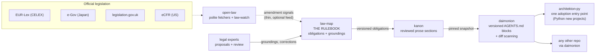

# Architecture / 全体図

The canonical diagram. Every repository README links here instead of
drawing its own. It reflects how the pieces actually connect — not an
aspiration.

Reading the diagram:

- **law-map is the rulebook** — the single source of truth for what software
  must and must not do, and which legal sources say so.
- **open-law feeds law-map thinly.** Its pipeline role is law-watch:
  noticing when a cited instrument is amended. The dotted line is honest —
  everything downstream works without it; it only makes rules go stale more
  slowly. (Its comparative-law research tools are extras, not pipeline.)
- **kanon renders** versioned obligations into short prose sections for
  people and agents.
- **daimonion reads a pinned snapshot** of those sections and writes the
  matching ones into any repository's `AGENTS.md`, plus scans diffs for
  triggers. It is the delivery tool, not the rulebook.
- **architekton-py is one adoption entry point** — for new Python projects —
  not the end of the pipeline. Any existing repository in any language
  adopts the rules through daimonion.
