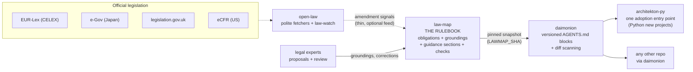

# Architecture / 全体図

The canonical diagram. Every repository README links here instead of
drawing its own. It reflects how the pieces actually connect — not an
aspiration.

Reading the diagram:

- **law-map is the rulebook** — the single source of truth for what software
  must and must not do, which legal sources say so, the short guidance
  sections rendered from them (merged from kanon), and the executable
  check specs.
- **open-law feeds law-map thinly.** Its pipeline role is law-watch:
  noticing when a cited instrument is amended. The dotted line is honest —
  everything downstream works without it; it only makes rules go stale more
  slowly. (Its comparative-law research tools are extras, not pipeline.)
- **daimonion reads a pinned snapshot** of the rulebook (guidance sections
  plus `checks/` specs, recorded as `LAWMAP_SHA`) and writes the
  matching rules into any repository's `AGENTS.md`, plus scans diffs for
  triggers. It is the delivery tool, not the rulebook.
- **architekton-py is one adoption entry point** — for new Python projects —
  not the end of the pipeline. Any existing repository in any language
  adopts the rules through daimonion.

Retired from this diagram: **kanon** (archived; its prose merged into
law-map `guidance/`). Version pairings: [versions.md](versions.md).
